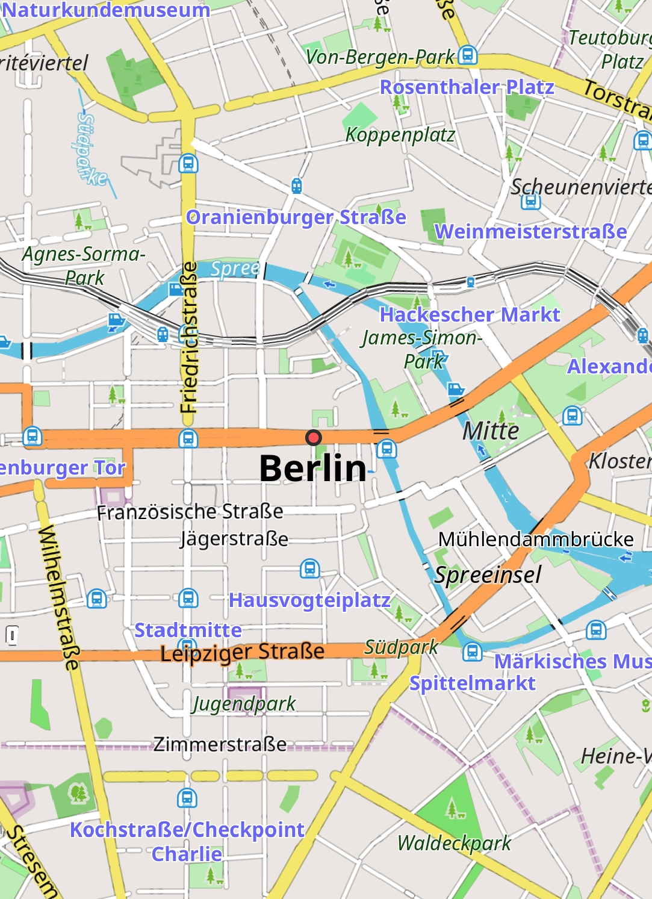
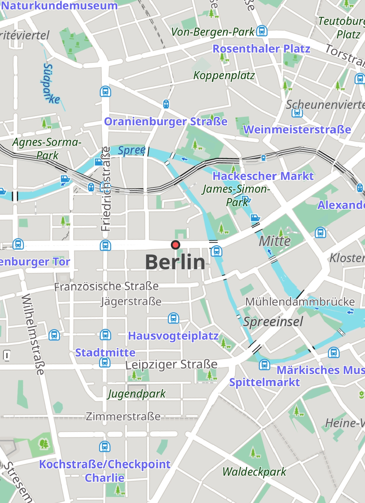

# Calm – a minimal map style for OsmAnd

A minimal map style for the [OsmAnd](https://osmand.net) Android app, with a light and a dark version. The colors are based on the [Protomaps](https://github.com/protomaps/basemaps) light and dark basemaps, adjusted so that labels and roads are easy to read.

Calm builds on OsmAnd's default style and only changes colors, so navigation, routing and OsmAnd's map settings work as usual.

| OsmAnd default | Calm |
|---|---|
|  |  |

Central Berlin, day mode. Map data © [OpenStreetMap](https://www.openstreetmap.org/copyright) contributors (ODbL); map icons from OsmAnd under their own licenses. The screenshots are not covered by this repo's MIT license.

## Install

1. Download [`Calm.render.xml`](Calm.render.xml) to your phone (on GitHub: open the file and tap the download button).
2. In OsmAnd, open **Menu → Maps & Resources → Local → Rendering styles**.
3. Tap **⋮** at the top right → **Import**, and choose `Calm.render.xml`.
4. Open **Configure map → Map style** and choose **Calm**.

To go back, choose another style under **Map style**. To update Calm, import the new file the same way and let OsmAnd overwrite the old one.

If OsmAnd doesn't show up under "Open with" in your file manager, use the import button described above.

## Light and dark

Calm follows OsmAnd's map mode (**Configure map → Map mode**): *Day* for light, *Night* for dark, or *Sunrise/sunset* to switch automatically.

Both versions are in one file because the parts Calm doesn't change, like POI icons and the route line, also take their day or night colors from the map mode.

## Notes

- Labels have at least 4.5:1 contrast against their background (WCAG AA) in both modes, except state and country names, which are lighter on purpose. Compared to Protomaps, roads are also easier to see at night, road edges are visible by day, and paths are darker.
- These OsmAnd options still work: cycle streets in the bicycle profile, highlighted pedestrian streets in the car and pedestrian profiles, roads under construction, **Show access restrictions**, **Street lighting**, winter and ice roads, **Hide polygons** and **Hide overground objects**.
- The **Road style** option and the extra color shades of **More details** have no effect, because Calm sets its own road and area colors.
- Only colors change. Line widths, zoom levels and symbols are the same as in OsmAnd's default style. This includes the tree symbols in forests, the patterns on beaches and wetlands, and a few night colors that the default style sets directly (sand, glaciers).
- Farmland and residential areas have no fill, as in Protomaps.
- Tested with OsmAnd for Android in October 2026. Other versions should work as long as the default style keeps its color names.

## Make your own style

You can use Calm as a starting point for your own style. All you need is a text editor.

1. Copy `Calm.render.xml` and rename it, for example to `MyStyle.render.xml`. The name must end in `.render.xml`.
2. Change `name="Calm"` at the top of the file. This is the name shown under **Map style**.
3. Change the colors. Each color is a `renderingAttribute` with a day case (`nightMode="false"`) and a night case (`nightMode="true"`). Colors are written as `#RRGGBB`, or `#AARRGGBB` with transparency (`00` is invisible, `ff` is solid).
4. To change more colors, look up their names in OsmAnd's [default.render.xml](https://github.com/osmandapp/OsmAnd-resources/blob/master/rendering_styles/default.render.xml) (search for `renderingAttribute name=`) and add them to your file.
5. Import the file as described under [Install](#install). After each change, import it again and let OsmAnd overwrite the old file.

Things to watch out for:

- End every color with a day case and a night case. If none of your cases matches, OsmAnd doesn't reliably fall back to the default color.
- Use literal color values. Names from the default style, like `$null` or `$woodColor`, aren't available in your file, and using them stops it from loading. Use `#00000000` for transparent.
- Overriding a color replaces all of the default's cases for it. If the default has special cases you want to keep, such as `baseAppMode="bicycle"` for cycle streets or `showAccess="true"` for access restrictions, copy them above your day and night cases, as Calm does.

The file format is described in OsmAnd's [rendering style docs](https://osmand.net/docs/technical/osmand-file-formats/osmand-rendering-style/).

## Credits and license

- The color palette is based on the [Protomaps basemaps](https://github.com/protomaps/basemaps) light and dark themes, whose visual design was created by Geraldine Sarmiento for Protomaps LLC and released under CC0. Calm is not an official Protomaps style.
- Map data © [OpenStreetMap](https://www.openstreetmap.org/copyright) contributors, via OsmAnd's maps.
- Calm builds on OsmAnd's default rendering style, which is not included here.
- `Calm.render.xml` is released under the [MIT License](LICENSE). The screenshots are not: they show OpenStreetMap data (ODbL) and OsmAnd's map icons, which keep their own licenses.

## Disclaimer

This is a personal project. I am not affiliated with OsmAnd or Protomaps. It is provided as is. Use it at your own risk.
